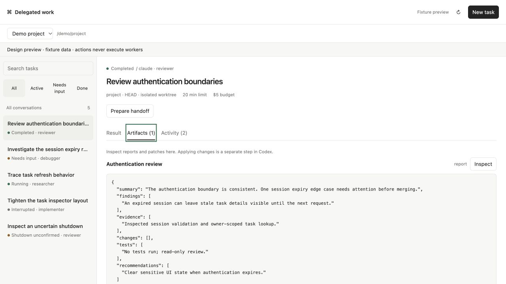
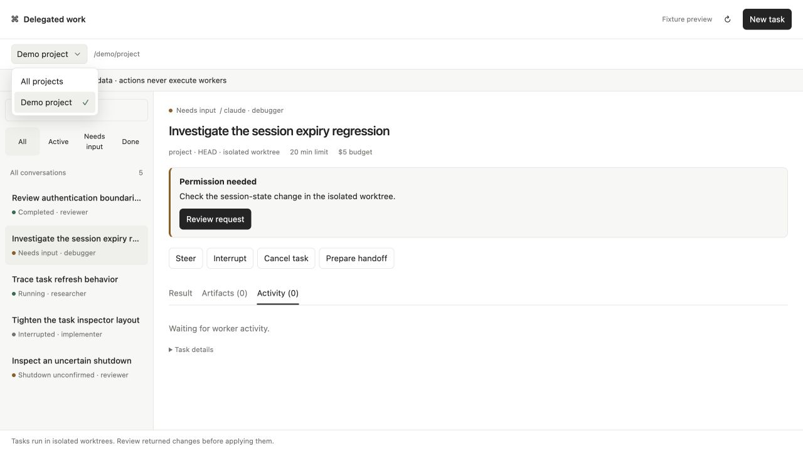

# React UI architecture

The standalone console and embedded delegation panel share one React application. Their entrypoints remain `ui/app.ts` (console) and `ui/codex.ts` (panel); `ui/bootstrap.tsx` selects a transport, creates a controller, and mounts the shell. Service APIs, MCP resources, standalone routes, and fixture preview remain the integration boundaries.

## Module boundaries

| Directory or file                                                               | Responsibility                                                                                                      |
| ------------------------------------------------------------------------------- | ------------------------------------------------------------------------------------------------------------------- |
| `ui/core/types.ts`                                                              | UI snapshots, dialog variants, and the transport contract; task/event/artifact models reuse server types.           |
| `ui/core/controller.ts`                                                         | Async requests, refresh scheduling, selection, navigation, scope changes, and submission lifecycle.                 |
| `ui/core/initial-state.ts`, `ui/core/delegation.ts`, `ui/core/event-history.ts` | Route initialization, delegation defaults, and bounded event pagination.                                            |
| `ui/core/selectors.ts`                                                          | Pure derived values, filtering, formatting, and capability decisions.                                               |
| `ui/transports/`                                                                | Console HTTP/SSE, MCP host bridge, and read-only fixture preview implementations.                                   |
| `ui/components/`                                                                | Focused presentation and interactions: task lists, status, actions, inspector sections, evidence tabs, and dialogs. |
| `ui/forms/`                                                                     | Form drafts, validation, and explicit submission; reusable fields and footer live beside the forms.                 |
| `ui/shells/`                                                                    | Page composition and console-specific worker navigation.                                                            |
| `ui/components/controller-context.tsx`                                          | Controller access and React subscriptions through `useSyncExternalStore`.                                           |
| `ui/shared.css`, `ui/console.css`, `ui/codex.css`                               | Shared component styling and mode-specific layout/theme rules.                                                      |

The controller owns durable UI state and async coordination. Components subscribe to immutable snapshots and call controller actions. Forms own their editable drafts through React Hook Form, so polling does not replace field nodes or reset unsent input. Pure rendering components can receive props without needing controller access.

Use Base UI (`@base-ui/react`) primitives for dialogs, tabs, single and multiple selection, project suggestions, and collapsible task details, including focus management and keyboard navigation. `SelectField` and `MultiSelectField` share dropdown structure and styling; `FormSelect` connects selection to React Hook Form. The project autocomplete accepts both registered projects and explicit absolute paths. Keep simple buttons, text inputs, and textareas as native controls. Base UI provides unstyled components; keep their styling in this project's stylesheets and application decisions in the controller/forms. React, React DOM, React Hook Form, and the official MCP Apps bridge supply existing infrastructure rather than custom equivalents.

## Extending the UI

- Add a component when a section has a clear responsibility, reused presentation, or an independent interaction. Compose these sections in the inspector or shell; avoid moving networking or scope bookkeeping into JSX.
- Reuse the selection fields for new dropdowns and the existing project autocomplete for editable project suggestions. Keep primitive styling in `ui/shared.css`; define surface colors through CSS variables in `ui/console.css` and `ui/codex.css`.
- Add a form for a new user-reviewed operation. Share fields and footers, declare its typed dialog variant, and wire it into `DialogHost`. Submit through `controller.submit` to retain busy/error handling and the scope captured when the dialog opened. Send messages or execute tools only after the user submits.
- Add a selector for a pure calculation shared across views. Keep transport calls and mutation outside selectors.
- Add a transport when the connection mechanism changes. Implement `Transport` and deliver `TransportEvents`; select it in bootstrap. Rendering and forms should not branch on HTTP versus MCP tool envelopes.

Keep scope handling centralized. Changing the project or conversation invalidates outstanding reads and stale dialogs. A submission already in flight must not be silently repeated in the new scope. Task/detail generation checks discard delayed responses after selection changes, and disposal cancels refresh scheduling and connection resources.

## Console, host, and preview behavior

The standalone console uses credentialed HTTP requests, token login, and SSE activity refreshes. Its task, worker, and artifact routes continue to use the existing paths. Embedded views use the MCP Apps bridge for tools, theme variables, selection context, display modes, and optional message delivery. Capabilities determine which host actions are available; opening the panel outside a host reports that MCP is required.

The embedded panel renders a compact summary in `inline` mode: project/chat scope, task counts, and the selected task's status. Counts cover the current scope even when the full panel has search or status filters applied. **Open panel** requests `fullscreen` when the host advertises it; the host controls placement. The full interface appears in expanded mode. Collapsing preserves task selection and hides any open dialog while retaining its draft for expansion. Scope changes still discard stale dialogs. The standalone console and fixture preview retain their full layout.

Task rows and the inline preview show the concise title. The inspector shows the full description in a disclosure that starts collapsed.

Opening either HTML entrypoint outside an iframe with `?preview=1` selects fixture data; `&theme=dark` selects the dark preview theme. Preview does not connect to the service or execute workers. Unsupported fixture operations fail explicitly. Native host rendering and delivery still require separate host verification.





## Build and verification

`scripts/build-ui.mjs` bundles each entrypoint with esbuild, the automatic JSX runtime, minification, and `process.env.NODE_ENV="production"`. It embeds JavaScript and CSS into `dist/console.html` and `dist/codex.html`, preserving self-contained HTML delivery without runtime CDN requests. The build also parses the final embedded module to catch template replacement corruption. Edit source files, then rebuild; generated HTML is not the source of truth.

```sh
npm run typecheck
npm test
```

`npm test` builds the project first through its `pretest` script.

Typechecking covers both server TypeScript and the browser/TSX configuration in `ui/tsconfig.json`. The test suite includes controller scope/race/lifecycle checks, HTTP and host transport contracts, and React Testing Library/user-event interactions in jsdom. React interaction tests cover keyboard tabs, dialog focus restoration, draft preservation through refresh, budgets, worker input, explicit handoff submission, and literal text rendering. Existing HTTP/MCP and generated-panel checks remain relevant. Automated DOM/protocol checks do not establish actual browser layout or native host placement; verify those separately for changes affecting them.
